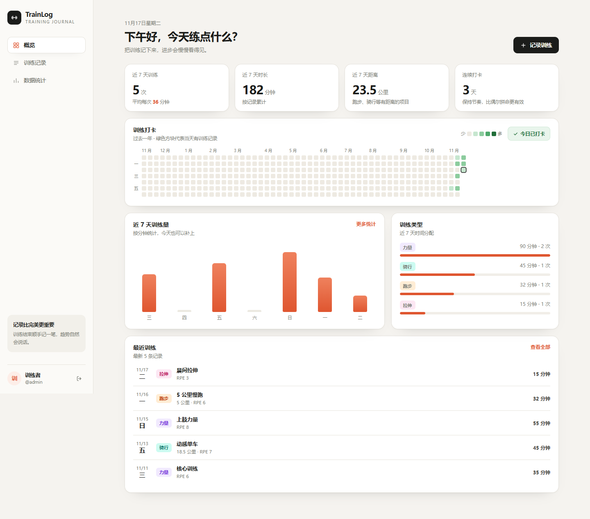
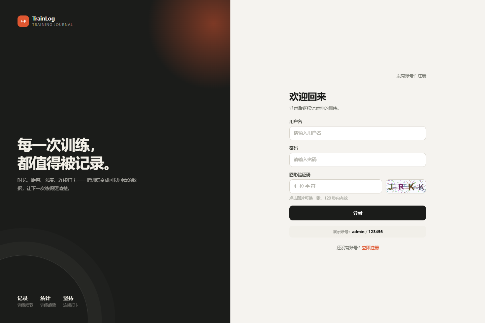
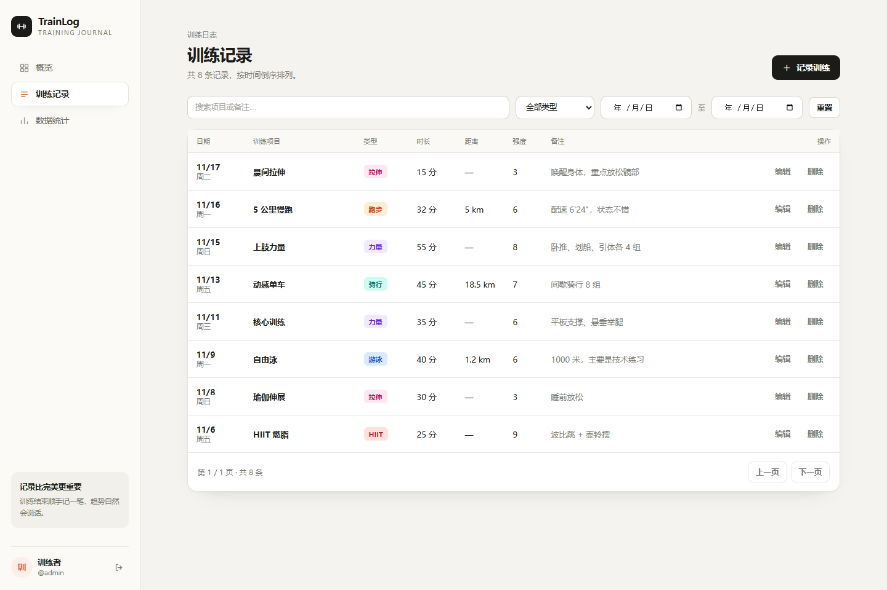
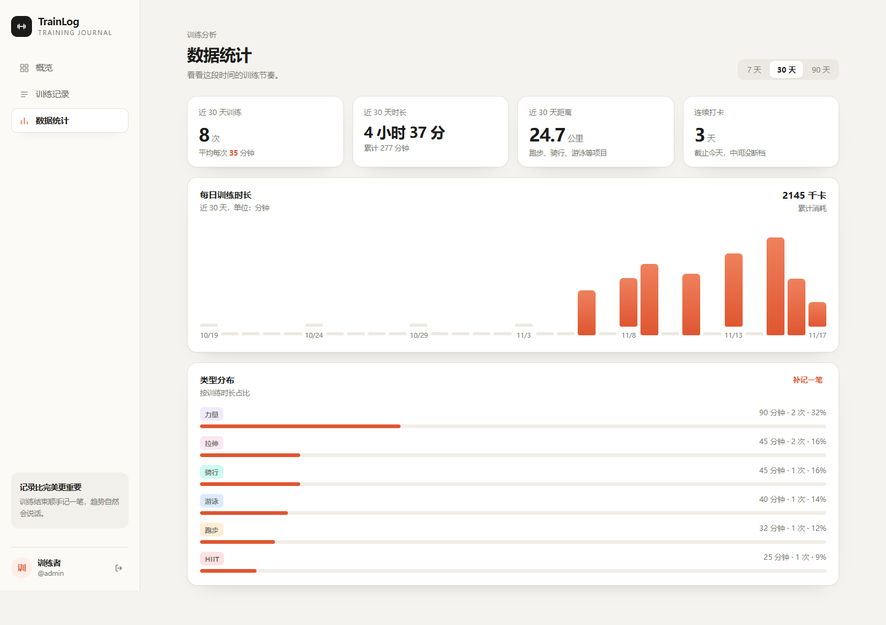

# TrainLog 训练记录

一个简约的训练记录应用：Vue 3 前端 + Spring Boot 后端。登录、注册、图形验证码和 JWT 鉴权沿用本机已有的登录模块，业务部分围绕训练记录展开。



## 功能

- 账号密码登录、自助注册，密码使用 BCrypt 加盐哈希存储
- 图形验证码一次性校验，登录 / 注册按 IP 限流，连续输错密码自动锁定
- 训练记录的新增、编辑、删除、搜索、类型筛选和日期筛选
- GitHub 风格「训练打卡」日历：有训练的日期显示为绿色方块，颜色越深代表当天训练时间越长，点击方块可直接补记当天训练
- 7 / 30 / 90 天统计：训练次数、总时长、总距离、连续打卡、每日时长趋势、类型分布
- 数据按用户隔离，所有训练接口都需要登录令牌

## 技术栈

| 层 | 技术 |
| --- | --- |
| 前端 | Vue 3、Vue Router 4、Axios、Vite 5 |
| 后端 | Spring Boot 3.2、Spring Data JPA、Spring Validation、JJWT |
| 数据库 | MySQL（dev profile），连接信息由环境变量注入 |
| 安全 | BCrypt、JWT（HS256）、图片验证码、接口限流 |

## 目录结构

```text
TrainLog/
├── backend/                      Spring Boot 单模块工程
│   ├── src/main/java/com/trainlog/
│   │   ├── controller/           接口层：Auth、Captcha、Training
│   │   ├── service/              业务接口，impl/ 下为具体实现
│   │   ├── mapper/               数据访问层
│   │   ├── entity/               数据库实体
│   │   ├── dto/                  请求参数
│   │   ├── vo/                   返回给前端的视图对象
│   │   ├── config/               密码编码器、MVC、初始化数据
│   │   ├── interceptor/          JWT 登录拦截器
│   │   ├── context/              ThreadLocal 登录上下文
│   │   ├── utils/                JWT、验证码、IP 工具
│   │   ├── constant/             训练类型、JWT 常量
│   │   ├── exception/            业务异常
│   │   ├── handler/              全局异常处理
│   │   ├── properties/           配置映射类
│   │   └── result/               统一返回、分页结果
│   ├── src/main/resources/       application.yml 及 dev 配置
│   └── sql/schema-mysql.sql      MySQL 建表脚本
├── frontend/                     Vue 3 前端
│   └── src/
│       ├── views/                登录、注册、概览、记录、统计
│       ├── components/           布局、记录弹窗、Toast
│       ├── api/                  接口封装
│       └── styles.css            设计样式
├── scripts/                      启动与冒烟测试脚本
└── docs/                         页面截图与后端练习指南
```

## 后端分层（按苍穹外卖风格）

请求链路：

```text
Controller -> Service -> ServiceImpl -> Mapper -> Entity/DB
```

- Controller 只负责接收参数、调用 Service、返回 `Result`
- Service 接口定义业务能力，`service/impl` 写具体逻辑
- Mapper 是数据访问层，当前使用 Spring Data JPA；想练 MyBatis 可以只替换这一层
- DTO 接收前端请求，VO 返回前端数据，Entity 只对应数据库表
- 登录用户由 `JwtTokenInterceptor` 解析后写入 `BaseContext`，业务层用 `BaseContext.getCurrentId()` 获取

训练模块的练习入口：

```text
controller/TrainingController.java
        -> service/TrainingService.java
        -> service/impl/TrainingServiceImpl.java
        -> mapper/TrainingRecordMapper.java
        -> entity/TrainingRecord.java
```

更完整的改写顺序、练习清单和新增业务示例见 [后端练习指南](docs/backend-guide.md)。

## 快速启动

环境要求：JDK 17+、Maven、Node 18+。脚本会自动寻找本机已安装的 JDK 和 Node。

### 1. 启动后端

```powershell
powershell -ExecutionPolicy Bypass -File scripts/start-backend.ps1
```

首次启动会自动编译并写入演示账号和示例训练记录。默认端口 **8081**。

也可以手动启动：

```powershell
cd backend
mvn spring-boot:run
```

### 2. 启动前端

```powershell
powershell -ExecutionPolicy Bypass -File scripts/start-frontend.ps1
```

浏览器打开 <http://localhost:5173>。

### 3. 登录

演示账号：**admin / 123456**，验证码按图片输入即可。

## 页面

| 登录 | 训练记录 |
| --- | --- |
|  |  |

| 打卡日历 | 数据统计 |
| --- | --- |
|  |  |

## 接口

统一返回结构 `json
{ "code": 0, "message": "ok", "data": null }
```，失败时 ```code``` 与 HTTP 状态码一致。

| 方法 | 路径 | 说明 | 需要 token |
| --- | --- | --- | --- |
| GET | `/api/captcha` | 获取图形验证码 | 否 |
| POST | `/api/auth/login` | 登录 | 否 |
| GET | `/api/auth/register-config` | 查询注册开关 | 否 |
| POST | `/api/auth/register` | 注册并直接登录 | 否 |
| GET | `/api/auth/me` | 当前登录用户 | 是 |
| POST | `/api/auth/logout` | 退出登录 | 是 |
| GET | `/api/training/types` | 训练类型列表 | 是 |
| GET | `/api/training/records` | 分页查询，支持 `from`、`to`、`type`、`keyword`、`page`、`size` | 是 |
| GET | `/api/training/records/{id}` | 单条训练记录 | 是 |
| POST | `/api/training/records` | 新增训练记录 | 是 |
| PUT | `/api/training/records/{id}` | 更新训练记录 | 是 |
| DELETE | `/api/training/records/{id}` | 删除训练记录 | 是 |
| GET | `/api/training/stats?days=30` | 统计汇总与每日数据 | 是 |

新增 / 更新请求示例：

```json
{
  "title": "上肢力量",
  "type": "STRENGTH",
  "trainingDate": "2026-11-17",
  "durationMinutes": 55,
  "distanceKm": null,
  "calories": 380,
  "intensity": 8,
  "notes": "卧推、划船、引体各 4 组"
}
```

训练类型：`STRENGTH` 力量、`RUNNING` 跑步、`CYCLING` 骑行、`SWIMMING` 游泳、`STRETCHING` 拉伸、`HIIT`、`BALL` 球类、`OTHER` 其他。

## 数据库

`spring.profiles.active` 为 `dev`，使用 MySQL，连接信息通过环境变量注入：

```powershell
$env:TRAINLOG_DATASOURCE_HOST = '你的 MySQL 地址'
$env:TRAINLOG_DATASOURCE_PASSWORD = '你的密码'
```

> 注意：`spring.datasource` 下目前用的是自定义键 `host / port / database`，Spring Boot 只认 `spring.datasource.url`，且代码中没有读取这些键的配置类，所以 dev 环境当前还连不上库。需要补一个 `DataSource` 配置类或改为标准 `url` 后才能正常连 MySQL；建表脚本见 [schema-mysql.sql](backend/sql/schema-mysql.sql)。

## 常用配置

| 配置项 | 默认值 | 说明 |
| --- | --- | --- |
| `SERVER_PORT` | 8081 | 后端端口 |
| `APP_JWT_SECRET` | dev-only-jwt-secret-change-me-0123456789abcdef | 生产环境务必替换 |
| `app.jwt.ttl-seconds` | 7200 | 登录有效期（秒） |
| `REGISTER_ENABLED` | true | 是否开放注册 |
| `REGISTER_INVITE_CODE` | 空 | 设置后注册需要邀请码 |
| `SEED_USERNAME` / `SEED_PASSWORD` | admin / 123456 | 首次启动的演示账号 |
| `app.security.login-per-minute` | 10 | 单 IP 每分钟登录请求上限 |
| `app.security.max-failures` | 5 | 连续密码错误锁定阈值 |
| `app.security.lock-seconds` | 600 | 锁定时长（秒） |

## 开发提示

- 前端开发服务器把 `/api` 代理到 `http://localhost:8081`，改端口时同步修改 `frontend/vite.config.js`
- 验证码答案默认不打进日志（`app.captcha.log-code: false`），调试时可临时改为 true
- 登录令牌存放在 `localStorage`，2 小时后过期，过期后访问接口会自动回登录页
- 后端 DTO 使用 Java `record`，实体使用 JPA，数据库表由 `ddl-auto=update` 自动维护

## 冒烟测试

后端以 local 配置启动后执行：

```powershell
powershell -ExecutionPolicy Bypass -File scripts/smoke-test.ps1
```

覆盖登录、鉴权、训练记录增删改查、统计、未登录拦截、注册和数据隔离。
